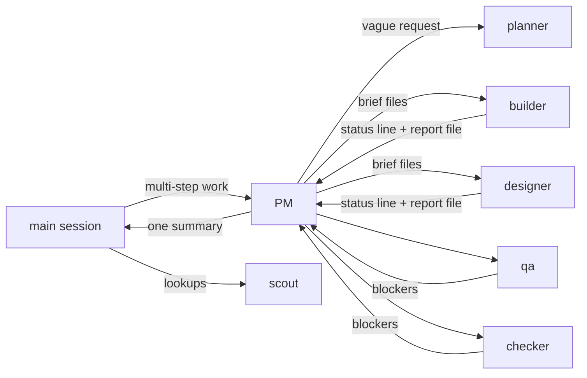

<div align="center">


**연장 한 번 안 드는 리더가 이끄는 Claude Code 에이전트 크루예요.**

[](https://code.claude.com/docs/en/plugins)
[](.claude-plugin/plugin.json)
[](LICENSE)

[English](README.md) | 한국어

</div>

> **완장(wanjang)**은 공사 현장 감독이 팔에 차는 띠예요. 작은 권한이 머리끝까지 오른 사람을 두고 하는 말이기도
> 하죠. *완장 차더니 사람이 달라졌다.* 여기서는 PM이 완장을 차요. PM은 계획하고, 일을 나눠 주고, 확인하고,
> 보고해요. 직접 만드는 일은 절대 하지 않아요. 훅이 그걸 막아요.

## 왜 쓰나요

- **메인 세션이 가벼워요.** 여러 단계가 필요한 일은 PM에게 가고, 돌아오는 건 짧은 요약 하나예요.
  브리프, 보고서, 기록은 파일에 남고 누구의 컨텍스트에도 쌓이지 않아요.
- **일마다 맞는 모델을 써요.** 조회와 단순 수정은 Haiku, 보통의 구현과 확인은 Sonnet, UI와 정말 어려운 부분은
  Opus예요. 실패한 일은 한 단계 위 모델로 다시 해요.
- **확인 없이 나가는 건 없어요.** QA는 사용자처럼 제품을 써 보고, checker는 빌드하고 테스트하고 요구사항을
  하나씩 짚어요. 인증, 결제, 권한이 걸리면 보안 검토도 해요.
- **중간에 끊겨도 한 단계만 잃어요.** 워커는 진행하면서 커밋하고, PM은 run 기록을 남겨요. 다음 세션이 알아서
  이어 받아요.
- **진행 중에는 묻지 않아요.** 정해도 되는 기본값은 정하고 목록으로 남겨요. run이 끝나면 한 번의 선택
  창에서 하나씩 검토해요(그대로 두거나 다른 안으로 바꾸거나). 되돌릴 수 없는 일만 미리 물어요.
- **대화 기록 대신 완료 보고서를 받아요.** 지금 쓸 수 있는 것(QA 스크린샷 포함), 보는 방법, 대신 정한 것,
  확인한 것이 들어 있어요.

## 바로 시작하기

```sh
claude plugin marketplace add levx-me/wanjang
claude plugin install wanjang@wanjang
```

새 세션을 시작하세요(또는 지금 세션을 다시 시작하세요). 평소처럼 기능을 부탁하면 돼요. 세션 시작 훅이 모든
세션에 라우팅 규칙을 넣어 주기 때문에, 여러 단계가 필요한 일은 알아서 PM에게 가요. 직접 넘기고 싶다면:

```text
/wanjang:wanjang add refresh tokens to the auth middleware
```

`/wanjang`만 치고 Enter를 눌러도 돼요. 첫 번째 후보로 떠요.

## run은 이렇게 흘러가요



1. **계획.** 요청이 모호하면 planner가 테스트할 수 있는 완료 기준을 담은 spec으로 만들어요. PM은 일을 레이어별로
   나누고(데이터와 서버, UI, 테스트, 문서), 레이어 사이의 계약(API 형태, 타입, testid)을 정해서 적어 둬요.
2. **브리프.** 워커마다 브리프 파일을 받아요. 읽을 playbook, 계약, 모든 워커가 함께 지킬 결정, 맡은 파일,
   돌려줄 내용이 들어 있어요.
3. **구현.** 서로 다른 파일을 맡은 워커는 동시에 일하고, 확인을 통과할 때마다 커밋하고, 한 줄 상태와 전체
   보고서 경로를 돌려줘요.
4. **확인.** QA는 테스트가 다루지 못하는 부분을 직접 써 보고, checker는 빌드와 테스트를 돌리며 요구사항을
   하나씩 확인해요.
5. **수정.** 찾은 문제는 그 부분을 맡은 워커에게 돌아가요. 최대 두 번이고, 그래도 안 되면 더 강한 모델이 맡아요.
6. **보고.** 메인 세션에 요약 하나를 보내고, 자세한 내용은 run 폴더 경로로 남겨요.

### 리서치 run

답이 문서로 나오는 질문(조사, 비교, 깊이 파고들기)은 리서치 run으로 PM에게 가요. PM은 질문을 보고 깊이를
정해요(빠르게, 보통, 깊게. 깊게는 빈틈을 2차로 다시 파요). 질문을 겹치지 않는 하위 질문으로 나누고, 하위
질문마다 scout를 한 명씩, 한 번에 최대 다섯 명까지 띄워요. scout는 출처 노트를 남겨요(주장마다 URL과 원문
확인 / 검색 요약 / 미확인 표시). 그다음 builder들이 부분을 나눠 동시에 쓰고, builder 한 명이 결론을 쓰면서
계산한 숫자를 모두 다시 계산해요. checker는 핵심 숫자와 인용을 확인해요. 결과로 `research.md`와 출처 노트를
받아요(데이터를 요청하면 `dataset.json`도요).

## 크루

| 에이전트 | 모델 | 프로젝트 수정 | 하는 일 |
|---|---|:-:|---|
| `wanjang:pm` | Sonnet. 먼저 알아내야 할 게 있으면 Opus | ✗ | 계획, 브리프, 수정 배분, run 기록, 한 번에 보고 |
| `wanjang:planner` | Opus | ✗ | 모호한 요청을 spec으로 만들어요: 목표, 흐름, 범위, 테스트할 수 있는 기준, 열린 질문 |
| `wanjang:scout` | Haiku | ✗ | 파일 찾기, 로그 읽기, 데이터 조회, 테스트 실행과 요약. 리서치 노트 작성 |
| `wanjang:builder` | 일에 따라 Haiku / Sonnet / Opus | ✓ | 서버, 데이터, 테스트, 문서, 수정 |
| `wanjang:designer` | Opus | ✓ | 사용자가 보는 모든 화면과 그 상태, 접근성 |
| `wanjang:qa` | Sonnet | ✗ | 실행 중인 제품을 써 보고 재현 순서와 함께 버그를 알려요 |
| `wanjang:checker` | Sonnet. 보안 검토는 Opus | ✗ | 빌드하고 테스트하고 spec의 요구사항을 하나씩 확인해요. 리서치 출처도 확인해요 |

읽기 전용 크루는 run 폴더에만 보고서, 노트, 긴 출력을 쓸 수 있어요. 역할은 분야가 아니라 권한과 비용으로 나눴어요.
분야별 노하우는 playbook에서 와요.

## 명령어

| 명령어 | 하는 일 |
|---|---|
| `/wanjang:wanjang <work>` | 이 세션에서 하지 않고 PM에게 일을 넘겨요 |
| `/wanjang:wanjang resume [run]` | 멈춘 run을 이어 해요(충돌, 연결 끊김, 재시작) |
| `/wanjang:optimize` | 에이전트를 멈추지 않은 채로, 이 세션의 토큰이 어디에 쓰이는지 보고 해당하는 것만 고쳐요 |
| `/wanjang:provider openrouter\|models\|presets\|claude\|key\|status` | 재시작 없이 이 세션을 claude.ai 구독과 OpenRouter 사이에서 옮겨요 |

`/wanjang:optimize`는 `bin/usage`를 실행해요. 디스크에 있는 세션 기록을 읽고 짧은 보고서를 보여 줘요. 메인
컨텍스트 크기, 가장 많이 차지한 도구 결과, 여러 번 다시 읽은 파일, 최근 10분 동안 일한 에이전트와 그 사용량,
계속 반복되는 오류, 아직 돌고 있는 백그라운드 명령, 진행 중인 run이요. 그다음 해당하는 해결책만 제안해요.
체크포인트와 바로 칠 수 있는 `/compact` 한 줄, 진행 중인 PM에게 아끼라고 알리기, 폭주하는 에이전트 정리하기,
출력이 많은 백그라운드 명령 멈추기요. 동의 없이 멈추는 건 없어요.

`/wanjang:provider`는 `bin/provider`를 실행해요. 이 프로젝트의 `.claude/settings.local.json`에서 `env`와
`apiKeyHelper`를 바꾸고, 실행 중인 세션은 저장하는 순간 그 파일을 다시 읽어요. `--user`를 주면
`~/.claude/settings.json`을 바꿔서 열린 세션 전부가 바뀌어요. OpenRouter 키는 파일이 아니라 macOS 키체인, 리눅스
`secret-tool`, 또는 `OPENROUTER_API_KEY`에서 읽어요. wanjang을 설치할 때는 키를 묻지 않아요. 키가 저장되지 않은 상태에서
`/wanjang:provider openrouter`를 처음 실행하면 OS 비밀번호 창(macOS, 리눅스는 `zenity`)이 뜨고, 입력한 키는 바로
키체인에 저장돼요. 나중에 키를 넣거나 바꿀 때는 `/wanjang:provider key`를 써요. `status`와 `claude`는 키를 묻지 않아요.
창을 띄울 수 없으면(SSH 접속 등) 키를 직접 저장하는 명령을 알려 줘요. 구독 로그인 토큰은 Anthropic에만 가고 프록시로 넘기지 않아요(Anthropic은 구독 로그인을 제3자 도구나
프록시에서 쓰는 걸 허용하지 않아요). OpenRouter로 가 있는 동안에는 claude.ai 로그인이 필요한 기능(원격 제어, 음성 입력,
claude.ai 커넥터)이 꺼져요.

`opus`, `sonnet`, `haiku` 자리에 어떤 OpenRouter 모델을 쓸지는 직접 골라요. `/wanjang:provider models`는 도구를 쓸 수 있는
OpenRouter 모델을 가격대별로 보여 주고 자리마다 하나씩 물어봐요. `--opus`, `--sonnet`, `--haiku`로 바로 정할 수도 있어요.
고른 조합은 `~/.config/wanjang/provider.json`에 저장되고(비밀 값은 없어요), 다음 `openrouter` 때 그대로 써요.
`--save 이름`으로 조합에 이름을 붙이고, `--preset 이름`으로 불러오고, `presets`로 목록을 봐요. `claude`로 돌아가면 설정 파일의
지정은 비우지만 저장한 조합은 남겨 둬요. `/model` 목록에는 계속 Opus, Sonnet, Haiku만 보여요. Claude Code의 게이트웨이 모델
찾기(`CLAUDE_CODE_ENABLE_GATEWAY_MODEL_DISCOVERY`)는 ID에 `claude`나 `anthropic`이 들어간 모델만, 그것도 시작할 때만 목록에
넣어서 다른 OpenRouter 모델은 띄울 수 없어요. 고른 모델은 그 세 이름으로 답해요.
실제로 한 세션이 재시작 없이 구독 → OpenRouter → 구독 순서로 응답하는 걸 확인했어요.

`/wanjang:provider`는 모델 없이 동작해요. 그래서 지금 쓰는 제공자가 답하지 못할 때도 바꿀 수 있어요. 입력하는 순간
훅(`bin/provider-hook`)이 바로 실행하고 결과를 보여 줘요. 모델 호출이 없어요(질문을 해야 하는 `models`만 모델을 거쳐요).
이전에는 OpenRouter 크레딧이 없으면 모든 요청이 실패했고, 되돌아가는 명령도 모델을 거쳐서 함께 막혔어요. 이걸 막는 장치가
두 가지 더 있어요. `openrouter`는 바꾸기 전에 OpenRouter 잔액을 보고, $0.50(`PROVIDER_MIN_CREDIT`)보다 적으면 구독에
그대로 머물러요. 그래도 OpenRouter에서 결제나 인증 오류로 턴이 실패하면 `bin/provider-fail`이 구독으로 되돌리고 데스크톱
알림으로 알려 줘요. `default`, `subscription`, `anthropic`은 `claude`와 같아요. 모델이 있든 없든 언제나 통하는 비상구는
`! <플러그인 폴더>/bin/provider claude`예요.

## run 폴더와 이어 하기

run마다 모든 것을 `.git/wanjang/<date>-<slug>/`에 둬요(`.git` 안이라 커밋되지 않아요):

| 파일 | 담는 것 |
|---|---|
| `log.md` | `Status`, 목표, 계약, 결정, 작업과 상태, 고친 파일, 다음 할 일 |
| `brief-<n>-<worker>.md` | 워커에게 맡긴 일 |
| `report-<n>-<worker>.md` | 워커가 한 일: `path:line — what`, 실행한 명령과 결과 |
| `review.diff`, 로그 | 긴 출력. 누구의 컨텍스트에도 넣지 않아요 |

그 저장소에서 새 세션을 열면 아직 진행 중인 run(최근 일주일 안에 건드린 것)을 한 줄 안내와 함께 알아서 이어
해요. 직접 하려면 `/wanjang:wanjang resume`을 쓰세요. 새로 뜬 PM은 기록을 git과 맞춰 보고, 끝난 일은 그대로
두고 이어서 해요. 기록이 열린 채로 보고하려고 하면 훅이 PM을 한 번 돌려보내요.

## Playbook

분야별 노하우는 에이전트를 늘리는 대신 Markdown playbook에 둬요. PM은 일을 나눌 때 목록을 읽고, 맞는 것
한두 개를 워커 브리프에 적어요. 고르기 전에는 아무것도 불러오지 않아요.

1. 프로젝트의 `.claude/playbooks/INDEX.md` (먼저 읽어요)
2. 모든 프로젝트에 쓰는 `~/.claude/playbooks/INDEX.md`

```markdown
- [postgres-migration](postgres-migration.md) — changing a live Postgres schema without downtime: lock levels, CONCURRENTLY, NOT VALID + VALIDATE
```

## 벤치마크

모든 구성에 같은 일을 줬어요. spec 하나로 Next.js 칸반 보드(API, 저장, 드래그 앤 드롭, 접근성)를 만드는 일을,
메인 모델 Opus로 Claude Code에서 headless로 돌렸어요. 숨긴 테스트가 API, 저장, 처음부터 끝까지의 흐름을
확인하고, 이름을 가린 Opus 리뷰가 코드를 일곱 기준(35점)으로 채점해요.

| 구성 | 숨긴 테스트 | 블라인드 리뷰 | 비용 (정가) | 시간 |
|---|:-:|:-:|--:|--:|
| Claude Code 단독 | 20/20 | 26 | $1.29 | 5.8분 |
| oh-my-claudecode (ultrawork) | 20/20 | 31 | $2.29 | 8.5분 |
| wanjang 0.5.5 | 20/20 | 33 | $3.12 | 16.2분 |

wanjang 0.5.5와 같은 블라인드 리뷰에서, 그 바탕이 된 이전 크루 설계는 29점이었어요. 구성마다 한 번씩 돌렸고,
점수는 여러 번의 리뷰에서 나왔고, 블라인드 점수는 리뷰마다 2점 정도 움직여요. 그러니 차이는 대략으로만
보세요. 품질을 올린 것: UI에 Opus, 모든 UI 변경에 QA와 checker, run마다 반복되던 버그를 위한 playbook
(optimistic-UI playbook이 오래된 새로고침과 되돌리기 경쟁 문제를 없앴어요). 비용과 시간을 줄인 것: 리더에
Sonnet, 오래 일한 워커를 이어 쓰는 대신 새로 띄우기, 브라우저 테스트는 QA에게 맡기기.

## 플러그인 구성

| 경로 | 내용 |
|---|---|
| `agents/` | 일곱 에이전트 |
| `ROUTING.md` | 세션 시작 훅이 모든 세션에 넣는 라우팅 규칙 |
| `bin/route` | 그 훅. 저장소에 끝나지 않은 run이 있으면 알려 줘요 |
| `bin/guard` | PreToolUse 훅: PM과 읽기 전용 크루는 run 폴더에만 쓸 수 있어요 |
| `bin/read-warn` | PreToolUse 훅: 메인 세션이 200줄 넘는 파일을 통째로 읽으면 경고해요(서브에이전트는 제외, 막지 않아요). `docindex search`/`outline`(`~/.claude/bin/docindex`, .md/.txt/.html용 로컬 FTS5 문서 색인)과 `/wanjang:docs`도 알려줘요 |
| `bin/close` | SubagentStop 훅: run 기록이 열린 채로 보고하려 하면 PM을 한 번 돌려보내요 |
| `bin/usage` | `/wanjang:optimize`의 토큰 보고서 |
| `bin/provider`, `bin/openrouter-key`, `bin/provider-hook`, `bin/provider-fail` | `/wanjang:provider`, 키 도우미, 모델 없이 실행하는 훅, 결제 오류 때 되돌리는 훅 |
| `skills/` | `/wanjang:wanjang`, `/wanjang:optimize`, `/wanjang:docs`, `/wanjang:provider` |
| `test/` | `guard.sh`, `read-warn.sh`, `close.sh`, `usage.sh`, `provider.sh` |

```sh
test/guard.sh   # guard: all cases pass
test/close.sh   # close: all cases pass
test/usage.sh   # usage: all cases pass
test/provider.sh  # provider: all cases pass
```

`bash`, `jq`, `git`, `python3`가 필요해요.

## 라이선스

[MIT](LICENSE)
