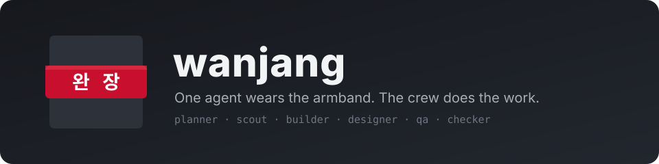
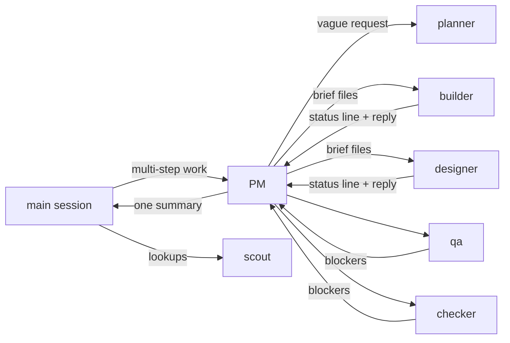

<div align="center">



**연장 한 번 안 드는 리더가 이끄는 Claude Code 에이전트 크루예요.**

[](https://code.claude.com/docs/en/plugins)
[](.claude-plugin/plugin.json)
[](LICENSE)

[English](README.md) | 한국어

</div>

> **완장(wanjang)**은 공사 현장 감독이 팔에 차는 띠예요. 작은 권한이 머리끝까지 오른 사람을 두고 하는 말이기도
> 하죠. *완장 차더니 사람이 달라졌다.* 여기서는 PM이 완장을 차요. PM은 계획하고, 일을 나눠 주고, 확인하고,
> 보고해요. 직접 만드는 일은 절대 하지 않아요. 훅이 그걸 막아요.

### 제품·마케팅 run

PM은 제품·마케팅 일도 맡아요. 고객 조사, 포지셔닝, 카피, 랜딩 페이지, 출시 계획, 가격, SEO 기초예요.
프로젝트마다 `docs/product-context.md` 하나(대상 고객, 대안, 차별점, 고객의 말, 말투)를 두고, 이런 일은 모두 이
파일을 먼저 읽어요. `positioning` playbook이 이 파일을 만들고, 모르는 것은 가정으로 표시해서 사용자에게
남겨요. scout는 공개 웹에서 고객과 경쟁사를 조사하고, planner는 계획을 세우고, builder는 카피를 쓰고,
designer는 페이지를 만들어요. checker는 주장을 playbook 기준표로 확인하고, QA는 대상 고객이 되어 읽어 보는
독자 테스트를 해요. 발송, 게시, 광고비 집행, 인터뷰, 실제 가격 변경은 크루가 절대 하지 않고 사용자가 할 일로
돌려줘요.

## 왜 쓰나요

- **메인 세션이 가벼워요.** 여러 단계가 필요한 일은 PM에게 가고, 돌아오는 건 짧은 요약 하나예요.
  브리프, 보고서, 기록은 파일에 남고 누구의 컨텍스트에도 쌓이지 않아요.
- **일마다 맞는 모델을 써요.** 조회와 단순 수정은 Haiku, 보통의 구현과 확인은 Sonnet, UI와 정말 어려운 부분은
  Opus예요. 추론 effort도 같은 식으로 정해요(low, medium, high). 실패한 일은 한 단계 위로 다시 해요.
- **매 턴이 가벼워요.** 메인 세션이 큰 파일을 통째로 읽으려 하면 먼저 경고해요(`bin/read-warn`). 문서는 통째로
  읽는 대신 `docindex`로 섹션 단위로 찾아요(실제 문서로 해 본 테스트에서, grep으로 찾아 읽는 방식이 놓친 섹션을
  찾았어요). 메인 전용 규칙은 워커에게 가지 않게 해요(`/wanjang:slim`으로 한 환경의 워커 지침 분량이 1.43만 자에서
  0.83만 자로 줄었어요). 워커는 쓰지 않는 Workflow 도구를 받지 않고, builder·checker·QA·planner는 Artifact 도구(시작마다 약 9천 토큰)도 받지 않아요. fork는 짧은 비코드 작업에만 써요.
- **확인 없이 나가는 건 없어요.** QA는 사용자처럼 제품을 써 보고, checker는 빌드하고 테스트하고 요구사항을
  하나씩 짚어요. 인증, 결제, 권한이 걸리면 보안 검토도 해요.
- **중간에 끊겨도 한 단계만 잃어요.** 워커는 진행하면서 커밋하고, PM은 run 기록을 남겨요. 다음 세션이 알아서
  이어 받아요.
- **진행 중에는 묻지 않아요.** 정해도 되는 기본값은 정하고 목록으로 남겨요. run이 끝나면 한 번의 선택
  창에서 하나씩 검토해요(그대로 두거나 다른 안으로 바꾸거나). 되돌릴 수 없는 일만 미리 물어요.
- **대화 기록 대신 완료 보고서를 받아요.** 지금 쓸 수 있는 것(QA 스크린샷 포함), 보는 방법, 대신 정한 것,
  확인한 것이 들어 있어요.

## 바로 시작하기

```sh
claude plugin marketplace add levx-me/wanjang
claude plugin install wanjang@wanjang
```

새 세션을 시작하세요(또는 지금 세션을 다시 시작하세요). 평소처럼 기능을 부탁하면 돼요. 세션 시작 훅이 모든
세션에 라우팅 규칙을 넣어 주기 때문에, 여러 단계가 필요한 일은 알아서 PM에게 가요. 직접 넘기고 싶다면:

```text
/wanjang:wanjang add refresh tokens to the auth middleware
```

`/wanjang`만 치고 Enter를 눌러도 돼요. 첫 번째 후보로 떠요.

## run은 이렇게 흘러가요



1. **계획.** 요청이 모호하면 planner가 테스트할 수 있는 완료 기준을 담은 spec으로 만들어요. PM은 일을 레이어별로
   나누고(데이터와 서버, UI, 테스트, 문서), 레이어 사이의 계약(API 형태, 타입, testid)을 정해서 적어 둬요.
2. **브리프.** 워커마다 브리프 파일을 받아요. 읽을 playbook, 계약, 모든 워커가 함께 지킬 결정, 맡은 파일,
   돌려줄 내용이 들어 있어요.
3. **구현.** 서로 다른 파일을 맡은 워커는 동시에 일하고, 확인을 통과할 때마다 커밋하고, 한 줄 상태와 전체
   보고서 경로를 돌려줘요. 브리프에는 `Deliverables: <경로>, <경로>` 줄이 들어 있어요. 그 파일 없이 멈춘 워커는
   한 번 돌려보내고(`bin/deliverables`, SubagentStop), 포그라운드 에이전트라면 부모에게도 알려요.
4. **확인.** QA는 테스트가 다루지 못하는 부분을 직접 써 보고, checker는 빌드와 테스트를 돌리며 요구사항을
   하나씩 확인해요.
5. **수정.** 찾은 문제는 그 부분을 맡은 워커에게 돌아가요. 최대 두 번이고, 그래도 안 되면 더 강한 모델이 맡아요.
6. **보고.** 메인 세션에 요약 하나를 보내고, 자세한 내용은 run 폴더 경로로 남겨요.

run이 막히면(spec이 정하지 않은 모호함, 코드와 맞지 않는 것으로 드러난 계획, 한 번 고쳐 봐도 원인을 모르는 버그)
PM이 자문 하나를 띄워요. Opus에 effort xhigh로 도는 planner이고, spec, 계획, 코드 지도, 지금까지의 결정을 한 번만
받아요. 그다음 막힘은 새 에이전트 없이 SendMessage로 같은 자문에게 보내요. 그래서 맥락은 한 번만 읽고 판단은
일관돼요. 질문이 15개쯤 쌓이면 새 자문으로 바꿔요. 자문은 정하기만 하고 코드는 builder가 써요. 판단마다 run 기록의
결정에 번호, 이유, 다른 안, 되돌리는 법과 함께 남아요. 막힌 적이 없는 run은 자문을 띄우지 않아요.

### 문서에서 찾기

`docindex`는 `.md`, `.txt`, `.html` 파일에서 필요한 섹션만 찾아 줘서, 아무도 파일을 통째로 읽지 않아도 돼요.

```sh
docindex search "<query>" <dir>   # 상위 섹션을 path:start-end  heading 과 발췌로 보여 줘요
docindex outline <file>           # 제목과 줄 범위, 크기
docindex index <dir> | stats | purge [path]
```

로컬 SQLite FTS5 색인이에요(porter 형태소 처리에 trigram을 더해서 한국어 단어의 일부만 쳐도 찾아요). 검색할 때
필요하면 색인하고 바뀐 파일은 다시 색인해요. 어떤 것도 컴퓨터 밖으로 나가지 않아요. 플러그인의 `bin/`에 들어 있어서
Claude 세션에서는 PATH에 있어요. `/wanjang:docs <query> [dir]`가 이걸 실행하고, 찾은 줄만으로 답해요.

### 리서치 run

답이 문서로 나오는 질문(조사, 비교, 깊이 파고들기)은 리서치 run으로 PM에게 가요. PM은 질문을 보고 깊이를
정해요(빠르게, 보통, 깊게. 깊게는 빈틈을 2차로 다시 파요). 질문을 겹치지 않는 하위 질문으로 나누고, 하위
질문마다 scout를 한 명씩, 한 번에 최대 다섯 명까지 띄워요. scout는 출처 노트를 남겨요(주장마다 URL과 원문
확인 / 검색 요약 / 미확인 표시). 그다음 builder들이 부분을 나눠 동시에 쓰고, builder 한 명이 결론을 쓰면서
계산한 숫자를 모두 다시 계산해요. checker는 핵심 숫자와 인용을 확인해요. 결과로 `research.md`와 출처 노트를
받아요(데이터를 요청하면 `dataset.json`도요).

## 크루

| 에이전트 | 모델 | effort | 프로젝트 수정 | 하는 일 |
|---|---|---|:-:|---|
| `wanjang:pm` | Sonnet. 먼저 알아내야 할 게 있으면 Opus | medium | ✗ | 계획, 브리프, 수정 배분, run 기록, 한 번에 보고 |
| `wanjang:planner` | Opus | high, 자문일 때 xhigh | ✗ | 모호한 요청을 spec으로 만들어요: 목표, 흐름, 범위, 테스트할 수 있는 기준, 열린 질문. 막힌 run에서는 자문으로 판단해요 |
| `wanjang:scout` | Haiku | low | ✗ | 파일 찾기, 로그 읽기, 데이터 조회, 테스트 실행과 요약. 리서치 노트 작성 |
| `wanjang:builder` | 일에 따라 Haiku / Sonnet / Opus | medium, 일에 따라 | ✓ | 서버, 데이터, 테스트, 문서, 수정, 카피 |
| `wanjang:designer` | Opus | high | ✓ | 사용자가 보는 모든 화면과 그 상태, 접근성 |
| `wanjang:qa` | Sonnet | medium | ✗ | 실행 중인 제품을 써 보고 재현 순서와 함께 버그를 알려요 |
| `wanjang:checker` | Sonnet. 보안 검토는 Opus | high | ✗ | 빌드하고 테스트하고 spec의 요구사항을 하나씩 확인해요. 리서치 출처도 확인해요 |

읽기 전용 크루는 run 폴더에만 보고서, 노트, 긴 출력을 쓸 수 있어요. 역할은 분야가 아니라 권한과 비용으로 나눴어요.
분야별 노하우는 playbook에서 와요.

## 명령어

| 명령어 | 하는 일 |
|---|---|
| `/wanjang:wanjang <work>` | 이 세션에서 하지 않고 PM에게 일을 넘겨요 |
| `/wanjang:wanjang resume [run]` | 멈춘 run을 이어 해요(충돌, 연결 끊김, 재시작) |
| `/wanjang:docs <query> [dir]` | .md/.txt/.html 문서에서 `docindex`로 섹션을 찾고, 찾은 줄만으로 답해요 |
| `/wanjang:now` | 돌아가는 에이전트가 지금 무엇을, 얼마나 오래 하는지, 끝난 것과 막힌 것 같은 것을 알려줘요(`bin/status`, 읽기 전용) |
| `/wanjang:next on\|off\|status` | 조용한 앞서 보기: 쉬는 동안 다음에 할 가장 그럴듯한 작업을 할지 한 번 물어봐요(기본 꺼짐, 이 세션만) |
| `/wanjang:slim` | 메인 세션에만 필요한 규칙을 모든 서브에이전트가 읽는 곳에서 빼내요(아래 참고) |
| `/wanjang:relay <세션> <요청>` · `status` | 이 컴퓨터에서 다른 저장소를 맡은 Claude 세션에 일을 넘기고 보고를 추적해요(Claude Code의 ListAgents/SendMessage) |
| `/wanjang:optimize` | 에이전트를 멈추지 않은 채로, 이 세션의 토큰이 어디에 쓰이는지 보고 해당하는 것만 고쳐요 |
| `/wanjang:provider openrouter\|models\|presets\|claude\|key\|status` | 재시작 없이 이 세션을 claude.ai 구독과 OpenRouter 사이에서 옮겨요 |

`/wanjang:optimize`는 `bin/usage`를 실행해요. 디스크에 있는 세션 기록을 읽고 짧은 보고서를 보여 줘요. 메인
컨텍스트 크기, 가장 많이 차지한 도구 결과, 여러 번 다시 읽은 파일, 최근 10분 동안 일한 에이전트와 그 사용량,
계속 반복되는 오류, 아직 돌고 있는 백그라운드 명령, 진행 중인 run이요. 그다음 해당하는 해결책만 제안해요.
체크포인트와 바로 칠 수 있는 `/compact` 한 줄, 진행 중인 PM에게 아끼라고 알리기, 폭주하는 에이전트 정리하기,
출력이 많은 백그라운드 명령 멈추기요. 동의 없이 멈추는 건 없어요.

`/wanjang:provider`는 `bin/provider`를 실행해요. 이 프로젝트의 `.claude/settings.local.json`에서 `env`와
`apiKeyHelper`를 바꾸고, 실행 중인 세션은 저장하는 순간 그 파일을 다시 읽어요. `--user`를 주면
`~/.claude/settings.json`을 바꿔서 열린 세션 전부가 바뀌어요. OpenRouter 키는 파일이 아니라 macOS 키체인, 리눅스
`secret-tool`, 또는 `OPENROUTER_API_KEY`에서 읽어요. wanjang을 설치할 때는 키를 묻지 않아요. 키가 저장되지 않은 상태에서
`/wanjang:provider openrouter`를 처음 실행하면 OS 비밀번호 창(macOS, 리눅스는 `zenity`)이 뜨고, 입력한 키는 바로
키체인에 저장돼요. 나중에 키를 넣거나 바꿀 때는 `/wanjang:provider key`를 써요. `status`와 `claude`는 키를 묻지 않아요.
창을 띄울 수 없으면(SSH 접속 등) 키를 직접 저장하는 명령을 알려 줘요. 구독 로그인 토큰은 Anthropic에만 가고 프록시로 넘기지 않아요(Anthropic은 구독 로그인을 제3자 도구나
프록시에서 쓰는 걸 허용하지 않아요). OpenRouter로 가 있는 동안에는 claude.ai 로그인이 필요한 기능(원격 제어, 음성 입력,
claude.ai 커넥터)이 꺼져요.

`opus`, `sonnet`, `haiku` 자리에 어떤 OpenRouter 모델을 쓸지는 직접 골라요. `/wanjang:provider models`는 도구를 쓸 수 있는
OpenRouter 모델을 가격대별로 보여 주고 자리마다 하나씩 물어봐요. `--opus`, `--sonnet`, `--haiku`로 바로 정할 수도 있어요.
고른 조합은 `~/.config/wanjang/provider.json`에 저장되고(비밀 값은 없어요), 다음 `openrouter` 때 그대로 써요.
`--save 이름`으로 조합에 이름을 붙이고, `--preset 이름`으로 불러오고, `presets`로 목록을 봐요. `claude`로 돌아가면 설정 파일의
지정은 비우지만 저장한 조합은 남겨 둬요. `/model` 목록에는 계속 Opus, Sonnet, Haiku만 보여요. Claude Code의 게이트웨이 모델
찾기(`CLAUDE_CODE_ENABLE_GATEWAY_MODEL_DISCOVERY`)는 ID에 `claude`나 `anthropic`이 들어간 모델만, 그것도 시작할 때만 목록에
넣어서 다른 OpenRouter 모델은 띄울 수 없어요. 고른 모델은 그 세 이름으로 답해요.
실제로 한 세션이 재시작 없이 구독 → OpenRouter → 구독 순서로 응답하는 걸 확인했어요.

`/wanjang:provider`는 모델 없이 동작해요. 그래서 지금 쓰는 제공자가 답하지 못할 때도 바꿀 수 있어요. 입력하는 순간
훅(`bin/provider-hook`)이 바로 실행하고 결과를 보여 줘요. 모델 호출이 없어요(질문을 해야 하는 `models`만 모델을 거쳐요).
이전에는 OpenRouter 크레딧이 없으면 모든 요청이 실패했고, 되돌아가는 명령도 모델을 거쳐서 함께 막혔어요. 이걸 막는 장치가
두 가지 더 있어요. `openrouter`는 바꾸기 전에 OpenRouter 잔액을 보고, $0.50(`PROVIDER_MIN_CREDIT`)보다 적으면 구독에
그대로 머물러요. 그래도 OpenRouter에서 결제나 인증 오류로 턴이 실패하면 `bin/provider-fail`이 구독으로 되돌리고 데스크톱
알림으로 알려 줘요. `default`, `subscription`, `anthropic`은 `claude`와 같아요. 모델이 있든 없든 언제나 통하는 비상구는
`! <플러그인 폴더>/bin/provider claude`예요.

### 다음 작업: `/wanjang:next`

`/wanjang:next on`은 이 세션에서만 조용한 앞서 보기를 켜요. 기본값은 꺼짐이고, `off`로 끄고 `status`로 상태를 봐요. 메인 세션이 쉬고 있으면 다음에 가장 쓸모 있을 작업 하나를 찾아 위저드 질문 하나로 물어봐요("X를 할까요? 왜 지금 / 무엇이 드는지", 선택지는 Do it (Recommended) / Not now). 승인했을 때만 실행하고, 직접 시킨 것과 똑같이 평소 라우팅으로 처리해요. push, 배포, 되돌릴 수 없는 단계는 따로 물어봐요.

살펴보는 때는 작업 하나가 끝난 직후 한 번(Stop 훅, 메인 세션 전용이고 서브에이전트에서는 돌지 않아요. 단순 질의응답 턴 뒤나 자체 백그라운드 작업이 도는 동안은 건너뛰어요), 그리고 세션이 쉬는 동안 30분마다예요(Claude Code가 턴 사이에 돌리는 세션 cron이라 `--resume`해도 이어져요. 점검할 때마다 일정이 있는지 확인하고 Claude Code의 7일 한도 하루 전에 갱신하므로, `/wanjang:next off`나 세션 종료 전까지 계속 돌아요. `off`는 일정을 지우고, 그 뒤로는 아무것도 다시 켜지 않아요). 보는 대상은 이 대화와 작업 목록(검증, 문서, 커밋 같은 후속 작업, 멈춘 대기 작업, 아직 보고하지 않은 서브에이전트 결과), 저장소(커밋하지 않은 변경, 바뀐 줄의 TODO/FIXME, `MEMORY.md`의 "next" 섹션, 끝나지 않은 wanjang run, 이미 본 실패한 테스트나 린트. 보려고 테스트를 돌리지는 않아요), 그리고 다른 세션(보고가 안 온 relay 요청, 이 세션을 기다리는 세션)이에요. GitHub는 보지 않아요.

찾은 것이 없으면 질문도 없고 메시지는 `·` 하나뿐이에요(Claude Code가 빈 응답을 거부해 자기 문구를 붙이기 때문이에요). 아무것도 못 찾을 점검(꺼져 있거나 25분 안에 이미 점검함)이면 `UserPromptSubmit` 훅이 모델이 돌기 전에 일정의 `/wanjang:next check`를 막아요. 이때 Claude Code가 모델 턴 없이 `· next check skipped: ...` 안내 한 줄을 보여줘요. `off` 뒤 첫 점검은 남은 일정을 지우도록 모델까지 가요. 한 번의 점검에 질문은 하나이고, 질문이 열려 있는 동안은 다음 점검이 돌지 않아요. 거절했거나 답하지 않은 후보는 근거가 바뀔 때까지(새 커밋, 새 실패, 새 메시지) 다시 묻지 않아요. `bin/next`가 그 기록을 `~/.claude/wanjang/next/<세션 id>.json`에 두고(`CLAUDE_CONFIG_DIR`를 따라요) 7일 뒤 지워요. 기록에는 `next`가 켜져 있는지 꺼져 있는지와 일정을 만든 시각도 들어 있어요. 점검은 메인 세션의 셸 스캔 한 번이고, 살펴보려고 서브에이전트를 띄우지 않아요.

## 메인 세션 전용 규칙과 `/wanjang:slim`

서브에이전트는 시작할 때마다 `~/.claude/CLAUDE.md`와 `~/.claude/rules/*.md`를 모두 읽어요. 한 환경에서 재 보니 워커 시작마다 약 1.8만 자였고, 워커가 턴을 돌 때마다 다시 비용이 들어요. 답변 언어, 보고 형식, 위저드로 결정 묻기 같은 규칙은 대부분 메인 세션에만 필요해요.

- **`main-rules/`**: 이런 파일을 `~/.claude/main-rules/` 또는 `<프로젝트>/.claude/main-rules/`에 두세요. 별도의 SessionStart 훅(`bin/main-rules`, startup, resume, clear, compact 모두)이 그 안의 `*.md`를 이름순으로, 각각 `Main-session rule (from <경로>):` 한 줄을 붙여 주입해요. 합계는 약 9.5K자까지예요. Claude Code가 훅 하나의 `additionalContext`를 10,000자로 제한하고(넘으면 파일 경로와 짧은 미리보기만 받아요) 라우팅 훅이 이미 약 5K자를 쓰기 때문이에요. 안 들어가는 파일은 건너뛰고 마지막 줄에 이름을 적어요. 실측: 서브에이전트 기록에는 SubagentStart 컨텍스트만 있고 SessionStart는 없어서, 서브에이전트는 이 파일을 읽지 않아요.
- **`/wanjang:slim`**: 서브에이전트가 읽는 파일의 크기를 보여 주고, 규칙 파일을 "메인 전용"과 "워커도 필요"로 나눈 뒤, 옮길 파일을 물어보고, 승인한 것만 `mv`로 옮겨요(되돌리는 방법도 알려 줘요). 끝나면 `/restart` 하세요.
- `main-rules/`는 Claude Code 기능이 아니라, 표준 SessionStart 훅 위에 얹은 wanjang의 약속이에요. wanjang 없이 쓰려면 그 파일들의 내용을 `{"hookSpecificOutput":{"hookEventName":"SessionStart","additionalContext":"..."}}`로 출력하는 SessionStart 훅을 직접 작성하면 돼요.

## run 폴더와 이어 하기

run마다 모든 것을 `.git/wanjang/<date>-<slug>/`에 둬요(`.git` 안이라 커밋되지 않아요):

| 파일 | 담는 것 |
|---|---|
| `log.md` | `Status`, 목표, 계약, 번호 붙은 결정(누가, 왜, 되돌리는 법), 사용자만 할 수 있는 일, 작업과 상태, 고친 파일, 다음 할 일 |
| `brief-<n>-<worker>.md` | 워커에게 맡긴 일 |
| `return-<n>-<worker>.md` | 워커가 돌려준 보고(PM이 저장):  `path:line — what`, 실행한 명령과 결과 |
| `review.diff`, 로그 | 긴 출력. 누구의 컨텍스트에도 넣지 않아요 |

그 저장소에서 새 세션을 열면 아직 진행 중인 run(최근 일주일 안에 건드린 것)을 한 줄 안내와 함께 알아서 이어
해요. 직접 하려면 `/wanjang:wanjang resume`을 쓰세요. 새로 뜬 PM은 기록을 git과 맞춰 보고, 끝난 일은 그대로
두고 이어서 해요. 기록이 열린 채로 보고하려고 하면 훅이 PM을 한 번 돌려보내요.

## Playbook

분야별 노하우는 에이전트를 늘리는 대신 Markdown playbook에 둬요. PM은 일을 나눌 때 목록을 읽고, 맞는 것
한두 개를 워커 브리프에 적어요. 고르기 전에는 아무것도 불러오지 않아요.

1. 프로젝트의 `.claude/playbooks/INDEX.md` (먼저 읽어요)
2. 모든 프로젝트에 쓰는 `~/.claude/playbooks/INDEX.md` (직접 추가하는 곳이에요. 이름이 같으면 플러그인 것보다 먼저 쓰여요)
3. 플러그인의 `playbooks/INDEX.md`: wanjang에 들어 있는 36개

```markdown
- [postgres-migration](postgres-migration.md) — changing a live Postgres schema without downtime: lock levels, CONCURRENTLY, NOT VALID + VALIDATE
```

이 playbook들을 플러그인의 `playbooks/INDEX.md`와 같은 묶음으로 보면 이래요.

| 묶음 | playbook |
|---|---|
| 데이터 | postgres-migration, postgres-schema-query |
| 백엔드와 배포 | api-design, deploy-config, cli-design, rust-cli |
| 스마트 컨트랙트 | solidity-foundry, contract-audit |
| 프론트엔드 | optimistic-ui, accessibility, nextjs-react-performance |
| 품질 | debugging, test-writing, code-review, security-review, readme |
| 도구 | claude-code-plugin |
| 제품·마케팅 | product-discovery, positioning, marketing-copy, page-cro, launch-plan, pricing-packaging, seo-basics |
| 문서 | deck, business-doc, pdf-pipeline |
| 재무·데이터 | spreadsheet-model, tokenomics-model, data-analysis, reconciliation-variance, accounting-treatment-memo |
| 법률·컴플라이언스 | legal-research, contract-review, crypto-regulatory-scope, privacy-compliance |

제품·마케팅 playbook은 우리 말로 쓴 짧은 절차이고, 출처의 글을 옮겨 오지 않았어요. 각 playbook 끝의
"Go deeper" 줄이 쓸 만한 외부 플러그인을 알려 줘요. 대신 설치해 주지는 않아요. run이 외부 플러그인으로 더 좋아질
것 같으면 PM이 "사용자만 할 수 있는 일"에 설치 명령을 적고, 메인 세션이 물어본 뒤 "예"면 그 플러그인만
설치해요(`claude plugin marketplace add <repo>`, 이어서 `claude plugin install <plugin>@<marketplace>`).
출처는 [coreyhaines31/marketingskills](https://github.com/coreyhaines31/marketingskills),
[anthropics/knowledge-work-plugins](https://github.com/anthropics/knowledge-work-plugins),
[wondelai/skills](https://github.com/wondelai/skills), [phuryn/pm-skills](https://github.com/phuryn/pm-skills),
[deanpeters/product-manager-skills](https://github.com/deanpeters/product-manager-skills)예요.

법률, 회계, 규제 playbook은 초안, 적용 범위 정리, 빠진 곳 목록까지만 만들고 의견이나 자문은 내지 않아요. 이런
run은 항상 사용자가 할 일로 끝나요. 변호사나 회계사 같은 자격 있는 전문가의 검토예요. 문서 playbook은 Anthropic의
docx, xlsx, pptx, pdf skill(독점 라이선스)을 언급만 하고 넣어 두지는 않아요.

라이선스: 저장소는 MIT이고 `cli-design`과 `security-review`는 CC BY-SA 4.0이에요. 모든 playbook의 출처와
라이선스는 [playbooks/NOTICE.md](playbooks/NOTICE.md)에 있어요.

## 벤치마크

모든 구성에 같은 일을 줬어요. spec 하나로 Next.js 칸반 보드(API, 저장, 드래그 앤 드롭, 접근성)를 만드는 일을,
메인 모델 Opus로 Claude Code에서 headless로 돌렸어요. 숨긴 테스트가 API, 저장, 처음부터 끝까지의 흐름을
확인하고, 이름을 가린 Opus 리뷰가 코드를 일곱 기준(35점)으로 채점해요.

| 구성 | 숨긴 테스트 | 블라인드 리뷰 | 비용 (정가) | 시간 |
|---|:-:|:-:|--:|--:|
| Claude Code 단독 | 20/20 | 26 | $1.29 | 5.8분 |
| oh-my-claudecode (ultrawork) | 20/20 | 31 | $2.29 | 8.5분 |
| wanjang 0.5.5 | 20/20 | 33 | $3.12 | 16.2분 |

wanjang 0.5.5와 같은 블라인드 리뷰에서, 그 바탕이 된 이전 크루 설계는 29점이었어요. 구성마다 한 번씩 돌렸고,
점수는 여러 번의 리뷰에서 나왔고, 블라인드 점수는 리뷰마다 2점 정도 움직여요. 그러니 차이는 대략으로만
보세요. 품질을 올린 것: UI에 Opus, 모든 UI 변경에 QA와 checker, run마다 반복되던 버그를 위한 playbook
(optimistic-UI playbook이 오래된 새로고침과 되돌리기 경쟁 문제를 없앴어요). 비용과 시간을 줄인 것: 리더에
Sonnet, 오래 일한 워커를 이어 쓰는 대신 새로 띄우기, 브라우저 테스트는 QA에게 맡기기.

## 플러그인 구성

| 경로 | 내용 |
|---|---|
| `agents/` | 일곱 에이전트 |
| `ROUTING.md` | 세션 시작 훅이 모든 세션에 넣는 라우팅 규칙 |
| `bin/route` | 그 훅. 저장소에 끝나지 않은 run이 있으면 알려 줘요 |
| `bin/guard` | PreToolUse 훅: PM과 읽기 전용 크루는 run 폴더에만 쓸 수 있어요 |
| `bin/read-warn` | PreToolUse 훅: 메인 세션과 서브에이전트가 `Read`, `cat`, `less`, 큰 `sed` 범위로 200줄 넘는 파일을 통째로 읽으면 경고해요(막지 않아요). `docindex search`/`outline`(`bin/docindex`, .md/.txt/.html용 로컬 FTS5 문서 색인)과 `/wanjang:docs`도 알려줘요 |
| `bin/deliverables` | 끝난 서브에이전트의 브리프(또는 프롬프트)에 `Deliverables: <경로>, <경로>` 줄이 있는데 파일이 없거나 비어 있으면, PostToolUse(`Agent`)는 부모에게 바로 알리고 SubagentStop은 워커를 한 번 돌려보내요 |
| `bin/main-rules` | SessionStart 훅: `main-rules/*.md`를 메인 세션에만 넣어요 |
| `bin/close` | SubagentStop 훅: run 기록이 열린 채로 보고하려 하면 PM을 한 번 돌려보내요 |
| `bin/status` | `/wanjang:now`의 스냅샷: 에이전트(중첩, 기다리는 도구 호출, 막힘), run 로그, 열린 작업 |
| `bin/next` | `/wanjang:next`의 Stop 훅과 그 스캔·기록 |
| `bin/usage` | `/wanjang:optimize`의 토큰 보고서 |
| `bin/provider`, `bin/openrouter-key`, `bin/provider-hook`, `bin/provider-fail` | `/wanjang:provider`, 키 도우미, 모델 없이 실행하는 훅, 결제 오류 때 되돌리는 훅 |
| `bin/docindex` | `/wanjang:docs`가 쓰는 로컬 문서 색인 |
| `skills/` | `/wanjang:wanjang`, `/wanjang:optimize`, `/wanjang:now`, `/wanjang:next`, `/wanjang:docs`, `/wanjang:slim`, `/wanjang:relay`, `/wanjang:provider` |
| `test/` | `guard.sh`, `read-warn.sh`, `deliverables.sh`, `docindex.sh`, `main-rules.sh`, `route.sh`, `close.sh`, `usage.sh`, `status.sh`, `provider.sh`, `next.sh`, `playbooks.sh` |

```sh
for t in test/*.sh; do "$t"; done   # 테스트마다 통과 요약을 출력해요
```

`bash`, `jq`, `git`, `python3`가 필요해요.

## 라이선스

[MIT](LICENSE). 두 playbook은 CC BY-SA 4.0이에요([playbooks/NOTICE.md](playbooks/NOTICE.md)).
