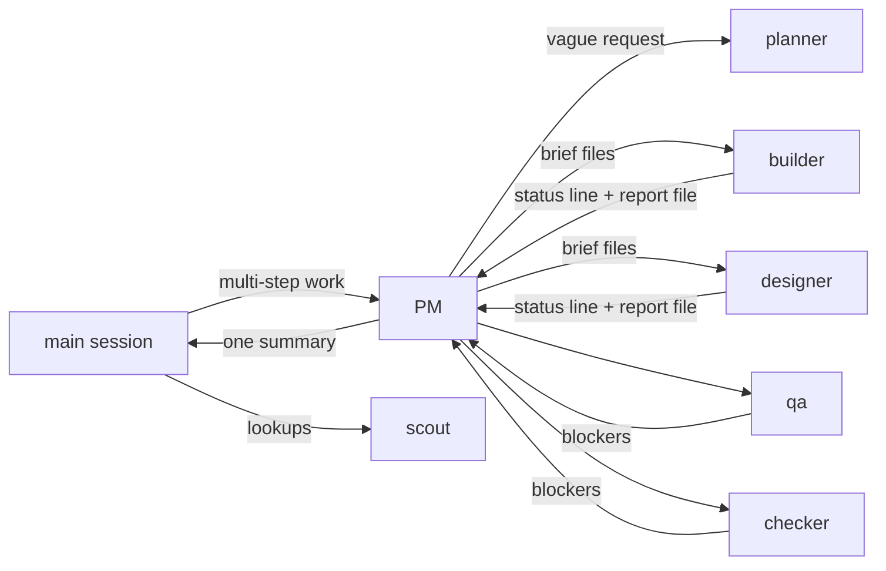

<div align="center">


**A crew of Claude Code agents, run by one that never picks up a tool.**

[](https://code.claude.com/docs/en/plugins)
[](.claude-plugin/plugin.json)
[](LICENSE)

English | [한국어](README.ko.md)

</div>

> **완장 (wanjang)** is the armband a site overseer wears in Korea, and the word for what happens when a little
> authority goes to someone's head: *완장 차더니 사람이 달라졌다*, "he put the armband on and became a different
> man". Here the armband goes to the PM. It plans, hands out work, checks it and reports. It never builds
> anything itself; a hook makes sure of that.

## Why

- **Your main session stays small.** Multi-step work goes to the PM; what comes back is one short summary.
  Briefs, reports and logs live in files, not in anyone's context.
- **Each task gets the model it needs.** Haiku for lookups and mechanical edits, Sonnet for ordinary building and
  checking, Opus for UI and the genuinely hard parts. A task that fails moves one tier up.
- **Nothing ships unchecked.** QA uses the product like a user; the checker builds, tests and walks the spec,
  with a security review for auth, payments and permissions.
- **A crash costs a step, not the run.** Workers commit as they go, the PM keeps a run log, and the next
  session picks the run up on its own.
- **No questions mid-run.** Sensible defaults are decided and listed; when the run ends you review each one in a
  single wizard (keep it, or pick the alternative). Only what cannot be undone is asked up front.
- **A completion report, not a transcript.** What you can use now (with QA's screenshots), how to see it, what was
  decided for you, what was checked.

## Quick start

```sh
claude plugin marketplace add levx-me/wanjang
claude plugin install wanjang@wanjang
```

Start a new session (or restart the current one). Ask for a feature as usual: multi-step work goes to the PM
on its own, because a session-start hook adds the routing rule to every session. To hand something over yourself:

```text
/wanjang:wanjang add refresh tokens to the auth middleware
```

Typing `/wanjang` and Enter is enough; it is the first match.

## How a run goes



1. **Plan.** A vague request goes to the planner for a spec with testable acceptance criteria. The PM splits
   the work by layer (data and server, UI, tests, docs), agrees the contract between them and writes it down.
2. **Brief.** Each worker gets a brief file: the playbooks to read, the contract, the decisions every worker must
   share, the files it owns, and what to return.
3. **Build.** Workers run in parallel where they own different files, commit each step once its checks pass, and
   return a one-line status with the path of their full report.
4. **Verify.** QA tries what no test covers; the checker runs the build and tests and checks every requirement.
5. **Fix.** Findings go back to the worker that owns the part, at most two rounds; then a stronger model takes over.
6. **Report.** One summary to the main session, with the run folder's path for the details.

### Research runs

A question whose answer is a document (a survey, a comparison, a deep dive) goes to the PM as a research run. It picks
the depth from the question (quick, standard, or deep with a second wave on the gaps), splits the question into
non-overlapping sub-questions and starts one scout per sub-question, up to five at once. Each scout writes source notes (claims with
URL and a verified / snippet / unverified flag). Builders then write the parts in parallel, one builder writes the
conclusion and recomputes every derived number, and the checker verifies the key numbers and quotes. You get
`research.md` and its source notes (plus `dataset.json` when you ask for data).

## The crew

| Agent | Model | Edits the project | Does |
|---|---|:-:|---|
| `wanjang:pm` | Sonnet; Opus when something must be found out first | ✗ | Plans, briefs, routes fixes, keeps the run log, reports once |
| `wanjang:planner` | Opus | ✗ | Turns a vague request into a spec: goal, flow, scope, testable criteria, open questions |
| `wanjang:scout` | Haiku | ✗ | Finds files, reads logs, queries data, runs tests and sums them up; writes research notes |
| `wanjang:builder` | Haiku / Sonnet / Opus, per task | ✓ | Server, data, tests, docs, fixes |
| `wanjang:designer` | Opus | ✓ | Every user-facing screen, with its states and accessibility |
| `wanjang:qa` | Sonnet | ✗ | Uses the running product and reports bugs with steps to reproduce |
| `wanjang:checker` | Sonnet; Opus for a security review | ✗ | Builds, tests and checks every requirement against the spec; checks research sources |

The read-only crew write only into the run folder (reports, notes, long output). Roles are split by permission and cost, not by
field: know-how for a field comes from playbooks.

## Commands

| Command | What it does |
|---|---|
| `/wanjang:wanjang <work>` | Hand the work to the PM instead of doing it in this session |
| `/wanjang:wanjang resume [run]` | Pick up a run that stopped (a crash, a lost connection, a restart) |
| `/wanjang:optimize` | See where this session's tokens go and fix what applies, with agents still running |
| `/wanjang:provider openrouter\|models\|presets\|claude\|key\|status` | Move this session between the claude.ai subscription and OpenRouter, no restart |

`/wanjang:optimize` runs `bin/usage`, which reads the session's transcripts on disk and prints a short report: the
main context, the tool results that took the most, files read again and again, agents active in the last ten
minutes with their recent spend and any error they keep repeating, background commands still running, and runs in
progress. It then offers only the fixes that apply: a checkpoint and a ready-made `/compact` line, telling a running
PM to economise, winding down a runaway agent, stopping a noisy background command. Nothing stops without a yes.

`/wanjang:provider` runs `bin/provider`, which rewrites `env` and `apiKeyHelper` in this project's
`.claude/settings.local.json`; the running session reloads the file on save. `--user` writes `~/.claude/settings.json`
and so switches every open session. The OpenRouter key comes from the macOS keychain, Linux `secret-tool` or
`OPENROUTER_API_KEY`, never from a file. Installing wanjang never asks for a key: the first `/wanjang:provider openrouter`
with no stored key opens an OS password dialog (macOS, or `zenity` on Linux) and stores what you type straight in the
keychain; `/wanjang:provider key` enters or replaces it later; `status` and `claude` never ask. Without a dialog (over
SSH) it prints the command to store the key yourself; the subscription's login token goes only to Anthropic and is never proxied (Anthropic does not allow
subscription logins in third-party tools or proxies). While on OpenRouter, features that need the claude.ai login
(Remote Control, voice, claude.ai connectors) are off.
Measured: one session answered on the subscription, then on OpenRouter, then on the subscription again, with no restart.

`/wanjang:provider` never needs the model, so it works even when the provider in use cannot answer: a hook
(`bin/provider-hook`) runs it as you type it and shows the result, with no model call (only `models`, which asks you
questions, goes through the model). That closes a lock-in: with no OpenRouter credit every request fails, and a
command that needed the model could not switch back. Two more guards: `openrouter` checks the OpenRouter balance first
and stays on the subscription below $0.50 (`PROVIDER_MIN_CREDIT`), and when a turn still fails on a billing or
authentication error while on OpenRouter, `bin/provider-fail` switches back to the subscription and says so in a desktop
notification. `default`, `subscription` and `anthropic` mean `claude`. The manual way out always works, model or not:
`! <plugin dir>/bin/provider claude`.

Which OpenRouter model answers for `opus`, `sonnet` and `haiku` is yours to pick: `/wanjang:provider models` lists
OpenRouter models that take tools, by price band, and asks one question per slot; `--opus`/`--sonnet`/`--haiku` set them
directly. The choice is saved (no secrets) in `~/.config/wanjang/provider.json` and reused by the next `openrouter`;
`--save NAME` keeps a named preset, `--preset NAME` applies it, `presets` lists them. `claude` blanks the overrides in the
settings file but keeps the saved choices. The `/model` picker keeps showing Opus, Sonnet and Haiku: Claude Code's
gateway model discovery (`CLAUDE_CODE_ENABLE_GATEWAY_MODEL_DISCOVERY`) lists only IDs that contain `claude` or `anthropic`
and runs only at startup, so it cannot surface other OpenRouter models; the picked models answer under those three names.

## Run folders and resuming

Each run keeps everything in `.git/wanjang/<date>-<slug>/` (inside `.git`, so it is never committed):

| File | Holds |
|---|---|
| `log.md` | `Status`, goal, contract, decisions, tasks and their status, files touched, next |
| `brief-<n>-<worker>.md` | What the worker was asked to do |
| `report-<n>-<worker>.md` | What it did: `path:line — what`, commands and results |
| `review.diff`, logs | Long output, kept out of everyone's context |

A new session in that repository resumes any run still in progress (touched in the last week) on its own, with a
one-line notice; `/wanjang:wanjang resume` does it by hand. A fresh PM checks the log against git, keeps what
is done and carries on. A hook sends the PM back once if it tries to report with its log still open.

## Playbooks

Specialist know-how lives in Markdown playbooks, not in more agents. The PM reads the indexes when it splits
work and names the one or two that fit in a worker's brief; nothing is loaded until it is picked.

1. `.claude/playbooks/INDEX.md` in the project (read first)
2. `~/.claude/playbooks/INDEX.md` for every project

```markdown
- [postgres-migration](postgres-migration.md) — changing a live Postgres schema without downtime: lock levels, CONCURRENTLY, NOT VALID + VALIDATE
```

## Benchmarks

Same task for every setup: a Next.js Kanban board (API, storage, drag and drop, accessibility) from one spec, run
headless on Claude Code with Opus as the main model. Hidden tests check the API, persistence and an end-to-end
flow; a blind Opus review scores the code on seven criteria (35 points).

| Setup | Hidden tests | Blind review | Cost (list price) | Time |
|---|:-:|:-:|--:|--:|
| Claude Code alone | 20/20 | 26 | $1.29 | 5.8 min |
| oh-my-claudecode (ultrawork) | 20/20 | 31 | $2.29 | 8.5 min |
| wanjang 0.5.5 | 20/20 | 33 | $3.12 | 16.2 min |

In the same blind round as wanjang 0.5.5, the earlier crew design it grew from scored 29. Each setup ran once, the
scores come from several review rounds, and blind scores move by about two points between
rounds, so read the gaps as rough. What moved quality in our runs: Opus on the UI, QA and a checker on every UI
change, and a playbook for the bugs runs kept repeating (an optimistic-UI playbook removed the stale-reload and
rollback races). What cut cost and time: Sonnet for the lead, fresh workers instead of resuming long-running ones,
and leaving browser testing to QA.

## What is in the plugin

| Path | What |
|---|---|
| `agents/` | The seven agents |
| `ROUTING.md` | The routing rule a session-start hook adds to every session |
| `bin/route` | That hook; it also names unfinished runs in the repository |
| `bin/guard` | PreToolUse hook: the PM and the read-only crew write only into run folders |
| `bin/read-warn` | PreToolUse hook: warns the main session (never a subagent, never blocks) when it reads a whole file over 200 lines |
| `bin/close` | SubagentStop hook: sends the PM back once if it tries to report with its run log still open |
| `bin/usage` | The token report behind `/wanjang:optimize` |
| `bin/provider`, `bin/openrouter-key`, `bin/provider-hook`, `bin/provider-fail` | `/wanjang:provider`, its key helper, the hook that runs it with no model, and the one that switches back on a billing error |
| `skills/` | `/wanjang:wanjang`, `/wanjang:optimize` and `/wanjang:provider` |
| `test/` | `guard.sh`, `read-warn.sh`, `close.sh`, `usage.sh` and `provider.sh` |

```sh
test/guard.sh   # guard: all cases pass
test/close.sh   # close: all cases pass
test/usage.sh   # usage: all cases pass
test/provider.sh  # provider: all cases pass
```

Requires `bash`, `jq`, `git` and `python3`.

## License

[MIT](LICENSE)
