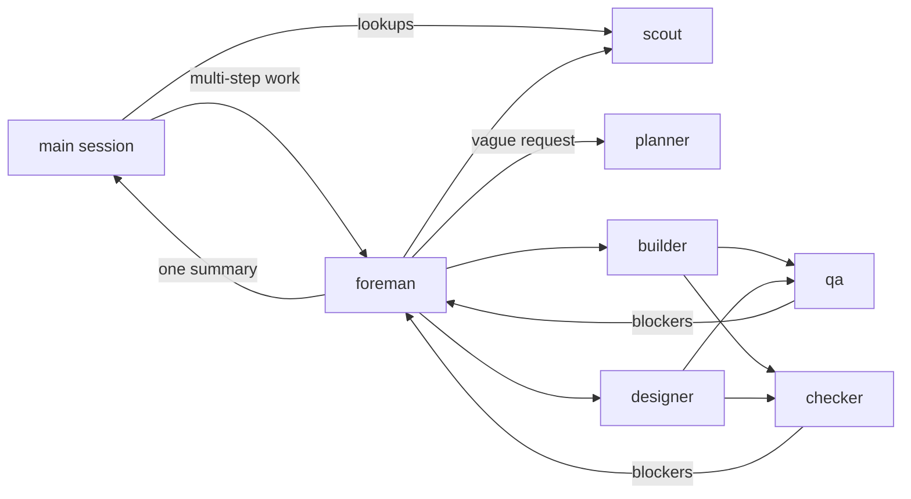

<div align="center">

# Foreman

**A foreman and its crew for Claude Code.**<br>
The foreman plans and delegates; a planner, builder, designer, scout, QA tester and checker do the work, each on the model the task needs.


</div>

## Features

- **Roles by permission and cost, not by field.** Seven agents cover nearly every project: what changes is the brief and the model, not the agent.
- **Model per task.** The foreman picks Haiku, Sonnet or Opus for each worker call, and moves a failed task one tier up.
- **The foreman never builds.** It plans, briefs and judges; a hook refuses file writes from its Bash, so fixes go to a worker.
- **Playbooks instead of a hundred agents.** Specialist know-how lives in Markdown playbooks that cost no context until the foreman picks one for a brief.
- **Verified before it reports.** QA uses the running product like a user; the checker runs the build and tests and checks every requirement, the docs and the accessibility basics, with a security review for auth, payments and permissions.
- **On by default.** A session-start hook puts the routing rule in every session; `/foreman` forces a hand-over.
- **Survives a crash.** A run log, step commits and `/foreman resume` pick a stopped run up where it was.

## Quick start

```sh
claude plugin marketplace add ~/workspace/foreman
claude plugin install foreman@foreman
```

Start a new session (or `/restart`). Ask for a feature as usual; multi-step work goes to the foreman on its own. To hand something over explicitly:

```text
/foreman add refresh tokens to the auth middleware
```

## The crew

| Agent | Model | Writes code | Does |
|---|---|---|---|
| `foreman:foreman` | Sonnet, Opus when something must be found out first | no | Splits the work by layer, agrees the contract, briefs workers with playbooks, runs QA and the checker, reports once |
| `foreman:planner` | Opus | no | Turns a vague request into a spec: goal, flow, scope, testable acceptance criteria, open questions |
| `foreman:scout` | Haiku | no | Finds files, reads logs, queries data, runs tests and summarises |
| `foreman:builder` | Haiku / Sonnet / Opus per call | yes | Server, data, tests, docs, fixes |
| `foreman:designer` | Opus | yes | All user-facing UI, with states and accessibility |
| `foreman:qa` | Sonnet | no | Uses the running product, reports bugs with steps to reproduce |
| `foreman:checker` | Sonnet, Opus for a security review | no | Builds, tests and checks every requirement against the spec |



## When a run stops

A crash, a lost connection or a restart kills the foreman and its workers mid-run. Three things keep the work:

- **Run log.** The foreman writes its plan and each task's status to `.git/foreman/<date>-<slug>.md` (never committed) and updates it as workers start and return.
- **Step commits.** The builder and designer commit each step as soon as its checks pass, so a crash costs at most the step in hand.
- **Resume.** A new session in that repository is told about any run still `in progress`. `/foreman resume` hands it back to a foreman, which checks the log against git, keeps what is done and carries on with the rest.

```text
/foreman resume
```

## Playbooks

A playbook is a Markdown file of know-how for one kind of work (a Postgres migration, Stripe webhooks, a security review). The foreman reads the indexes when it splits work and names the playbooks that fit in a worker's brief:

1. `.claude/playbooks/INDEX.md` in the project (read first)
2. `~/.claude/playbooks/INDEX.md` for every project

```markdown
- [postgres-migration](postgres-migration.md) — schema changes on a live Postgres: locks, backfills, rollbacks
```

Add one when a kind of work keeps coming back. Nothing is loaded until it is picked.

## What is in the plugin

| Path | What |
|---|---|
| `agents/` | The seven agents |
| `ROUTING.md` | The routing rule a session-start hook adds to every session |
| `bin/route` | That hook; it also names any unfinished run in the repository |
| `bin/guard` | PreToolUse hook: refuses file writes from the foreman, except its run log |
| `skills/foreman/` | The `/foreman` command |
| `test/guard.sh` | Checks the guard on commands the foreman might send |

```sh
test/guard.sh   # guard: all cases pass
```

## License

MIT
