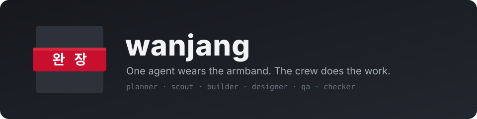
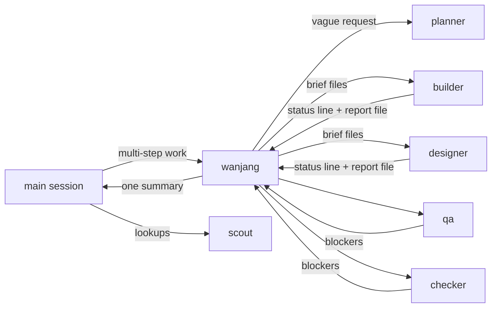

<div align="center">



**A crew of Claude Code agents, run by one that never picks up a tool.**

[](https://code.claude.com/docs/en/plugins)
[](.claude-plugin/plugin.json)
[](LICENSE)

</div>

> **완장 (wanjang)** is the armband a site overseer wears in Korea, and the word for what happens when a little
> authority goes to someone's head: *완장 차더니 사람이 달라졌다*, "he put the armband on and became a different
> man". Here the armband goes to one agent. It plans, hands out work, checks it and reports. It never builds
> anything itself; a hook makes sure of that.

## Why

- **Your main session stays small.** Multi-step work goes to the wanjang; what comes back is one short summary.
  Briefs, reports and logs live in files, not in anyone's context.
- **Each task gets the model it needs.** Haiku for lookups and mechanical edits, Sonnet for ordinary building and
  checking, Opus for UI and the genuinely hard parts. A task that fails moves one tier up.
- **Nothing ships unchecked.** QA uses the product like a user; the checker builds, tests and walks the spec,
  with a security review for auth, payments and permissions.
- **A crash costs a step, not the run.** Workers commit as they go, the wanjang keeps a run log, and
  `/wanjang:wanjang resume` picks up where it stopped.

## Quick start

```sh
claude plugin marketplace add levx-me/wanjang
claude plugin install wanjang@wanjang
```

Start a new session (or restart the current one). Ask for a feature as usual: multi-step work goes to the wanjang
on its own, because a session-start hook adds the routing rule to every session. To hand something over yourself:

```text
/wanjang:wanjang add refresh tokens to the auth middleware
```

Typing `/wanjang` and Enter is enough; it is the first match.

## How a run goes



1. **Plan.** A vague request goes to the planner for a spec with testable acceptance criteria. The wanjang splits
   the work by layer (data and server, UI, tests, docs), agrees the contract between them and writes it down.
2. **Brief.** Each worker gets a brief file: the playbooks to read, the contract, the decisions every worker must
   share, the files it owns, and what to return.
3. **Build.** Workers run in parallel where they own different files, commit each step once its checks pass, and
   return a one-line status with the path of their full report.
4. **Verify.** QA tries what no test covers; the checker runs the build and tests and checks every requirement.
5. **Fix.** Findings go back to the worker that owns the part, at most two rounds; then a stronger model takes over.
6. **Report.** One summary to the main session, with the run folder's path for the details.

## The crew

| Agent | Model | Edits the project | Does |
|---|---|:-:|---|
| `wanjang:wanjang` | Sonnet; Opus when something must be found out first | ✗ | Plans, briefs, routes fixes, keeps the run log, reports once |
| `wanjang:planner` | Opus | ✗ | Turns a vague request into a spec: goal, flow, scope, testable criteria, open questions |
| `wanjang:scout` | Haiku | ✗ | Finds files, reads logs, queries data, runs tests and sums them up |
| `wanjang:builder` | Haiku / Sonnet / Opus, per task | ✓ | Server, data, tests, docs, fixes |
| `wanjang:designer` | Opus | ✓ | Every user-facing screen, with its states and accessibility |
| `wanjang:qa` | Sonnet | ✗ | Uses the running product and reports bugs with steps to reproduce |
| `wanjang:checker` | Sonnet; Opus for a security review | ✗ | Builds, tests and checks every requirement against the spec |

The read-only crew may write only their reports, into the run folder. Roles are split by permission and cost, not by
field: know-how for a field comes from playbooks.

## Commands

| Command | What it does |
|---|---|
| `/wanjang:wanjang <work>` | Hand the work to the wanjang instead of doing it in this session |
| `/wanjang:wanjang resume [run]` | Pick up a run that stopped (a crash, a lost connection, a restart) |
| `/wanjang:optimize` | See where this session's tokens go and fix what applies, with agents still running |

`/wanjang:optimize` runs `bin/usage`, which reads the session's transcripts on disk and prints a short report: the
main context, the tool results that took the most, files read again and again, agents active in the last ten
minutes with their recent spend and any error they keep repeating, background commands still running, and runs in
progress. It then offers only the fixes that apply: a checkpoint and a ready-made `/compact` line, telling a running
wanjang to economise, winding down a runaway agent, stopping a noisy background command. Nothing stops without a yes.

## Run folders and resuming

Each run keeps everything in `.git/wanjang/<date>-<slug>/` (inside `.git`, so it is never committed):

| File | Holds |
|---|---|
| `log.md` | `Status`, goal, contract, decisions, tasks and their status, files touched, next |
| `brief-<n>-<worker>.md` | What the worker was asked to do |
| `report-<n>-<worker>.md` | What it did: `path:line — what`, commands and results |
| `review.diff`, logs | Long output, kept out of everyone's context |

A new session in that repository is told about any run still in progress (touched in the last week), and
`/wanjang:wanjang resume` hands it to a fresh wanjang that checks the log against git, keeps what is done and
carries on.

## Playbooks

Specialist know-how lives in Markdown playbooks, not in more agents. The wanjang reads the indexes when it splits
work and names the one or two that fit in a worker's brief; nothing is loaded until it is picked.

1. `.claude/playbooks/INDEX.md` in the project (read first)
2. `~/.claude/playbooks/INDEX.md` for every project

```markdown
- [postgres-migration](postgres-migration.md) — changing a live Postgres schema without downtime: lock levels, CONCURRENTLY, NOT VALID + VALIDATE
```

## Benchmarks

Same task for every setup: a Next.js Kanban board (API, storage, drag and drop, accessibility) from one spec, run
headless on Claude Code with Opus as the main model. Hidden tests check the API, persistence and an end-to-end
flow; a blind Opus review scores the code on seven criteria (35 points).

| Setup | Hidden tests | Blind review | Cost (list price) | Time |
|---|:-:|:-:|--:|--:|
| Claude Code alone | 20/20 | 26 | $1.29 | 5.8 min |
| oh-my-claudecode (ultrawork) | 20/20 | 31 | $2.29 | 8.5 min |
| wanjang 0.3.2 | 20/20 | 31 | $3.16 | 22.9 min |

Each setup ran once, the scores come from two review rounds, and blind scores move by about two points between rounds, so read the gaps as rough. What
moved quality in our runs: Opus on the UI, and QA and a checker on every UI change. What cut cost: Sonnet for the
lead, and fresh workers instead of resuming long-running ones.

## What is in the plugin

| Path | What |
|---|---|
| `agents/` | The seven agents |
| `ROUTING.md` | The routing rule a session-start hook adds to every session |
| `bin/route` | That hook; it also names unfinished runs in the repository |
| `bin/guard` | PreToolUse hook: the wanjang and the read-only crew write only into run folders |
| `bin/usage` | The token report behind `/wanjang:optimize` |
| `skills/` | `/wanjang:wanjang` and `/wanjang:optimize` |
| `test/` | `guard.sh` and `usage.sh` |

```sh
test/guard.sh   # guard: all cases pass
test/usage.sh   # usage: all cases pass
```

Requires `bash`, `jq`, `git` and `python3`.

## License

[MIT](LICENSE)
