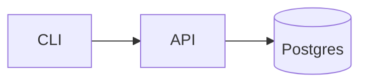

# Writing a project README

> Sources: [makeareadme.com](https://www.makeareadme.com) ([dguo/make-a-readme](https://github.com/dguo/make-a-readme), MIT), the user's own `~/.claude/rules/readme-guide.md` · Written 2026-10-20 · Applies to: any (GitHub-flavoured Markdown)

**Use when:** creating, rewriting or auditing a `README.md` for a repo or package. For API reference sites or CONTRIBUTING files, keep the README short and link out.

## Before you start
- Read the code and scripts first: `package.json` scripts / `pyproject.toml` / `Makefile`, `.env.example`, CI config, `LICENSE`, the entry point. A README written from memory goes stale; write from what the repo does now.
- Find real values for: repo URL (`git remote -v`), package name, licence, CI workflow filename, default branch.
- If a README exists, read it fully and keep what is still true; check git history for the project's voice.
- Check the project's rule for languages (some READMEs are in another language or bilingual); follow the existing one.

## Rules

### Structure (omit sections that do not apply; keep this order)
1. **Title**, with centred logo/banner if one exists (`<p align="center">`).
2. **Badge row**, only real ones (CI, version, licence). Every badge URL must resolve and point at this repo; no `USER/REPO` placeholders.
3. **One-line description**: what it does and for whom, understandable within five seconds. Not a slogan. Bad: "A next-gen platform for modern workflows." Good: "Deck pane for Claude Code that shows agents, jobs and git state beside the terminal."
4. **Screenshot or demo GIF/SVG** if the project has a UI or visible output. It must match the current version.
5. **Table of contents** only if the README exceeds roughly 300 lines.
6. **Features**, a short bullet list of what is different from alternatives.
7. **Quick start / installation**: requirements with versions (Node 20+, Python 3.11+, OS), then the fewest copy-pasteable commands to a working result. Include the expected output of the last step.
8. **Usage**: small examples in code blocks with their output; link to longer docs.
9. **Configuration**: a table of env vars and flags: name, required?, default, meaning. Link to `.env.example`. Never real secrets.
10. **Architecture** (if more than one moving part): a Mermaid diagram, not ASCII art:

11. **API reference**: terse; long response examples in `<details><summary>`.
12. **Development / Contributing**: clone, install, run tests, lint, how to open a PR; or link `CONTRIBUTING.md`.
13. **Support / status**: where to ask; say at the top if the project is paused or archived.
14. **Licence**: name and link to the `LICENSE` file, which must exist.

### Writing
15. Lead with the reader's goal ("run it"), not history or philosophy. One idea per paragraph; cut adjectives.
16. Use fenced code blocks with a language tag; use `sh` for commands without a `$` prompt so they copy cleanly.
17. Link to terms or tools that readers may not know, once.
18. Describe the repo as it is: no roadmap promises you cannot keep, no feature that does not exist.

### Remove boilerplate
19. Delete template text you did not write: create-next-app ("This is a Next.js project bootstrapped with..."), Vite/CRA ("Getting Started with Create React App"), cookiecutter or GitHub "Describe your project" stubs, "Learn More" link lists, Vercel deploy buttons you do not use, empty headings, TODO placeholders.

### Test it
20. Run every command from a clean clone in a scratch directory (`d=$(mktemp -d) && git clone . "$d" && cd "$d"`; a clone has only committed files, so commit or stash first), in order, and compare to what the README claims. Fix the README or the project, not just the symptom.

## Pitfalls
- **Quick start that needs an undocumented step** (env file, migration, global tool). Found only by running from clean.
- **Pasting `.env` values**: use `.env.example` with fake placeholders on `example.com`.
- **Badges for services not configured** show "unknown" or 404.
- **Relative image links** that break on package registries (npm, PyPI); use absolute URLs if the README is published there.
- **Stale screenshots** after a UI change. Regenerate when the UI changes (check project rules, some repos generate them from a script).
- **Version drift**: "requires Node 16" while `engines` says 20.
- **Over-long README**: move depth into `docs/` and link; a longer README is still better than a missing one.
- **Missing licence** or a mismatch between README and `LICENSE`.

## Verify
- Clean-clone run of every command in Quick start and Usage succeeds; outputs match.
- Every link and badge returns 200: `grep -oE "https?://[^]<>)\"' ]+" README.md | sed 's/[.,;:]*$//' | sort -u | xargs -n1 curl -sL -o /dev/null --max-time 15 -w '%{http_code} %{url}\n' | grep -v '^200'` prints only the broken ones (empty output = all good; private repos and some sites that block bots show 403/404 falsely, check those by hand; `%{url}` needs curl 7.75+).
- `grep -nE 'USER/REPO|TODO|Lorem|bootstrapped with' README.md` finds nothing.
- Mermaid block renders (paste into https://mermaid.live or view on GitHub).
- `LICENSE` exists and matches; env table matches `.env.example`.
- First paragraph answers "what is this" without scrolling.

## Skeleton
```markdown
<p align="center"></p>
<h1 align="center">name</h1>

One-line description.

## Quick start
(commands, then expected output)

## Usage
## Configuration
## Development
## License
```
Keep the heading names plain and stable; other docs may link to the anchors.
